<p align="center">
  
</p>

<p align="center"><b>Spec-driven development for AI coding agents</b></p>

I'm [@nikovijay](https://x.com/nikovijay), a Product Director with 20 years
of experience in software delivery. nikOS is my personal framework for
building products with AI coding agents. I'm sharing it to help others get
started with agentic programming practices. For where I think this is going,
see my thoughts on
[the software factory of the near future](https://www.nikovijay.com/software-factory).

## What it does

AI coding agents are quick to say "done". nikOS makes them prove it. Your
story map, plans and acceptance criteria live in your repo as plain files,
each criterion is a Cucumber scenario that runs as a test, and a story can't
be marked done until its scenarios pass. Your agent follows a named playbook
for each request instead of improvising, and every decision is written down
where the next person (or agent) can find it.

It works with Claude Code, Codex and Cursor, and brings spec-driven
development, behaviour-driven development (BDD) with Gherkin and Cucumber,
user story mapping and acceptance criteria to agentic coding.

> Early work in progress. Open source, MIT licensed.

## Try it in 10 minutes

[docs/quickstart.md](docs/quickstart.md) takes an empty repo to one passing
scenario, with every command and the output you should see.

## Install in your agent tool

| Tool | Command |
| --- | --- |
| Claude Code | `/plugin install nikos --marketplace nikovijay/NikOS` |
| Codex | `codex plugin marketplace add nikovijay/NikOS` |
| Cursor | Add `https://github.com/nikovijay/NikOS` as a plugin marketplace |

Then ask your agent to plan or build a story: the `nikos-mode` skill takes it
from there. The skills run the `nikos` command through `npx`, so there's
nothing else to install. More in [docs/install.md](docs/install.md).

## The loop

```bash
npx -y nikos init                     # create intent/ with a starter story
# write the story's scenarios in intent/features/
npx -y nikos verify setup             # add a Cucumber runner for your stack
npx -y nikos verify TC-1              # run the story: it fails until it's built
# build it, then
npx -y nikos state set TC-1 done      # refused unless its scenarios pass
```

With an agent, you only write the request ("add a story for X and build
it"); the playbooks run these steps and stop at each point that needs you.

## What lives in your repo

```text
intent/
├── constitution.md      who it's for, the problem, what proves it works
├── storymap.yaml        activities and steps, releases, and the order to build stories in
├── state.yaml           each story's status: todo, in_progress, needs_rework, done
├── decisions.md         why things are the way they are, append-only
├── features/            one .feature file per story; its scenarios are the criteria
│   └── <activity>/<story>.feature
└── plans/               how each story will be built, versioned: <story>.v<N>.md
```

Every file is plain text you can read, review and diff. The full format:
[docs/format.md](docs/format.md). A worked example:
[examples/hello-todo](examples/hello-todo/intent).

## Commands

| Command | What it does |
| --- | --- |
| `nikos init` | Create `intent/` in this repo |
| `nikos validate` | Check `intent/` is well formed |
| `nikos story add "<title>"` | Add a story to the map, state and a starter feature |
| `nikos step add "<title>"` | Add a step under an activity |
| `nikos release add\|rename\|move\|reorder\|remove` | Define releases and move stories between them, keeping feature tags in step |
| `nikos release check <n>` | Say whether a release is ready to ship, and what's in the way |
| `nikos clear <id>` | Check a story is ready to build |
| `nikos plan new <id>` | Start the next version of a story's plan |
| `nikos verify setup` | Add a Cucumber runner for this repo's stack |
| `nikos verify [id]` | Run a story's scenarios, or all of them |
| `nikos state set <id> <status>` | Move a story; done only if its scenarios pass; cancelled needs a reason |
| `nikos approve <id>` | Sign off a done story yourself, in your terminal |
| `nikos next` | Print the next story to build |
| `nikos show <id>` | Summarise a story: feature, status, plan, bets, decisions |
| `nikos decide "<title>"` | Append a decision to `decisions.md` |
| `nikos decisions "<q>"` | Quote the decisions about a topic or story |
| `nikos map` | Write a read-only story map page |
| `nikos export --format prd\|linear\|jira` | Write the story map as a PRD or a Linear or Jira import |

## Links

- Home: https://nikos.tools
- Quickstart: [docs/quickstart.md](docs/quickstart.md)
- Install: [docs/install.md](docs/install.md)
- Format: [docs/format.md](docs/format.md)
- Writing stories as features: [docs/gherkin.md](docs/gherkin.md)

MIT licensed.
