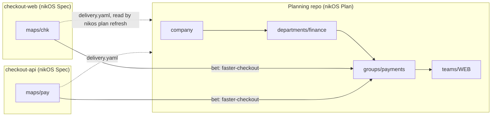

# RFC: nikOS Plan and nikOS Spec

**Status:** draft, for review. Nothing here is built yet.

## Summary

nikOS becomes two products that work together or alone:

- **nikOS Plan** is for leaders, PMs and anyone who plans. It lives in **one
  planning repo per company**. Every altitude has a folder in it: the company,
  each department, each group and each team. It holds objectives, key results,
  bets, check-ins, reviews and the planning dashboard.
- **nikOS Spec** is for engineers and their agents. It lives **in the code
  repos**. It holds story maps, features and scenarios, story plans, verify,
  the done gate and approvals.

The two products meet at one small contract:

- **From Spec to Plan:** a story map names the bet it delivers.
- **From Plan to Spec:** the Plan reads each map's committed `delivery.yaml`.

A bet can have many story maps, in one code repo or several. Nothing else
crosses between repos.

This replaces the chain of linked plan repos from the RFC
[plans, bets, story maps and team assignments](plans-bets-story-maps.md). The
level model from that RFC stays: key results stop at department level, and
teams have bets but never key results. What changes is where things are
stored and how they reach each other.

## Why

Linking plan repos together worked, but every release found new ways for the
links to go wrong. The 0.4.0 retest found three:

- **Bets above the group looked idle.** A company bet with no stories of its
  own said "Not started", although a department bet and a group bet were
  delivering it. Fixing this meant following `aligns_to` through copies of
  other repos.
- **Copies went stale.** The company saw delivery as of its last
  `nikos planning rollout`. That rollout read a department's copy of a group's
  summary, which could itself be out of date.
- **Each repo kind needed its own handling.** `suggest`, the MCP `status` tool
  and the dashboard all needed a separate path for each kind of repo: plan
  only, group, team, or a group with several maps.

Behind these were more parts that each had to be kept right: `downstream.yaml`,
`upstream.yaml`, `.nikos/downstream` copies, `index.json`, homes,
`assignments.yaml`, `nikos sync` and `.nikos/assigned`.

Most of this is plan-to-plan linking, and that is the part one repo removes. A
company's plans change a few times a quarter and are written by a few dozen
people. Merging in one repo is easy at that pace. One repo also means:

- A department changes its alignment to the company in one commit, with one
  review.
- The dashboard sees every level at once, live, so it can let people move
  between altitudes and drill down. No snapshot is needed.

Story maps can't move into the planning repo the same way. A story is done
only when its scenarios pass against the code. Its approval holds only while
that code hasn't changed since it was tested. Both checks need the code next
to the map, so maps stay in the code repos.

## The two products

| | nikOS Plan | nikOS Spec |
| --- | --- | --- |
| For | Leaders, PMs, anyone planning | Engineers and their agents |
| Lives in | One planning repo per company | Each code repo |
| Holds | Objectives, key results, bets, check-ins, reviews, decisions | Story maps, features, scenarios, story plans, approvals |
| Changes | A few times a quarter | Every day |
| Works alone | Yes: bets can be delivered anywhere, even in a tracker | Yes: a map doesn't need a bet |
| Commands | `nikos plan …` | `nikos story …`, `verify`, `state`, `approve` and the rest, as today |
| Dashboard | Every altitude, with drill-down | The repo's story maps |



## nikOS Plan

### The planning repo

```
nikos.settings.yaml               the company's settings and locks, as today
planning/
  company/
    plan.yaml                     name, year (period: 2027), pillars, owner
    krs/<id>.yaml                 annual key results, with their check-ins
    bets/<id>.md                  company bets
    decisions.md
  departments/<id>/
    plan.yaml                     name, owner, members
    krs/<id>.yaml                 period: a quarter (2027-Q1); aligns_to: company KRs, or none
    bets/<id>.md                  aligns_to: company bets, or none
    decisions.md
  groups/<id>/
    plan.yaml                     name, department (or none), owner, members
    bets/<id>.md                  no krs/: groups have no key results
    decisions.md
  teams/<key>/
    team.yaml                     name, key, group or department (its home), members, repos
    bets/<id>.md                  the team's own bets, if any: no key results, and no plan.yaml
  repos.yaml                      the code repos whose story maps deliver bets here
```

The rules:

1. **The folders are the levels.** A plan's level is its folder:
   `company/`, `departments/`, `groups/` or `teams/`. There is no `level:`
   field and no `nikos join` between plans. A department names nothing above
   it, because the company is the folder above. A group names its department,
   or none when it plans straight against the company. A team names its home
   group or department, as `home:` did.
2. **The level model is unchanged.** Only the company and departments have
   key results. Bets exist at every level. A bet aims at company or department
   key results (`krs.primary`, `krs.also`) and may align to one or more bets
   at any level above (`aligns_to`). `nikos plan validate` refuses a `krs/`
   folder under `groups/` or `teams/`.
3. **Ids are unique within the company.** Key result, bet, group,
   department and team ids are unique across the whole company, so a link
   inside the planning repo is just the id: `aligns_to: [one-inbox]`. From a
   code repo, a link names the repo: `acme/plan#faster-checkout`.
   `nikos plan validate` reports a clash and names the folders that use the
   id. A private area in another repo (rule 8) belongs to the same company,
   so its ids are checked against the rest too. Team keys, and the story ids
   built from them, are unique within the company as today.
4. **The company plans by year, departments by quarter.** The company's
   `period` is a year (`2027`), and its key results are annual. A
   department's key results each carry a quarter (`period: 2027-Q1`) inside
   the company's year, and may align to the company's annual key results. A
   new quarter means new department key results. The last quarter's stay,
   with their check-ins, as history. Groups and teams have no period of their
   own. Their bets run as long as they need to, with their own review dates,
   and the dashboard shows them against the department's quarters.
5. **A team can take part beyond its home.** A team's bets and its maps' bets
   may align to bets in any department or group, as in the amendment to the
   earlier RFC. The folder a team sits in says where it reports. It doesn't
   limit what it can work on.
6. **Settings come down the folders.** `nikos.settings.yaml` at the root is
   the company's. Each area may have its own `settings.yaml` that changes what
   the company hasn't locked, as with linked repos today. A code repo takes its
   settings from the planning repo and from its owning team's chain of folders.
7. **People can only edit their own areas.** `nikos plan owners` writes a
   `CODEOWNERS` file from each area's `owner` and `members`. Both GitHub and
   GitLab read it, and GitLab also gets one section per area. With branch
   protection, a department's lead reviews changes to that department's
   folder. Anyone can still read every area.
8. **A private area is the exception, not the rule.** When an area's plan
   must stay private, its folder can hold just `linked.yaml`, naming another
   planning repo with the same layout. The Plan reads it the way rollouts read
   linked repos today, with the reader's own access, and shows when it was
   read. This is not in the first PRs.

### Delivery from the code repos

`planning/repos.yaml` lists the code repos:

```yaml
- repo: acme/checkout-web
- repo: acme/checkout-api
  host: gitlab.com
```

`nikos plan refresh` reads each repo's default branch, read-only, with the
person's own git access. From each `maps/*/storymap.yaml` it takes `bet:` and
`owner:`, and it takes the committed `maps/*/delivery.yaml` beside each one.
It saves what it read in `.nikos/delivery/`, which git ignores, with the time
of reading. This is the only cross-repo read left.

What a bet shows:

- **A bet's own delivery** is every map whose `bet:` is that bet, added up as
  today: stories, done, done and approved, not current with its feature, and
  in progress.
- **A bet with no maps of its own** shows what delivers it below. Inside one
  repo, that is a plain walk down `aligns_to`: no copies and no hops between
  repos.
- **When it was read.** Each figure says how old it is ("read today", "read
  3 days ago"). `nikos plan serve` refreshes on start unless `--offline` is
  given.

When a code repo runs `nikos join acme/plan`, it adds itself to `repos.yaml`
on a new branch for review, the way `nikos join` writes `downstream.yaml`
today.

### The dashboard: altitudes and areas

`nikos plan serve` opens one dashboard for the whole company:

- **Altitude, then area.** An altitude switcher (Company · Departments ·
  Groups · Teams) sits at the top. Next to it is an area picker for the chosen
  altitude: which department, which group, which team. A breadcrumb shows the
  path, for example Company › Finance › Payments › WEB. Each part is a link.
- **Drill down and back up.** From a department's key result or bet, you can
  open the groups and teams whose bets align to it, then the story maps that
  deliver those bets. From any bet, you can go up the chain it aligns to.
- **One page per area, same pages as today.** Each area keeps today's pages:
  Key results (company and departments only), OKRs and bets, the OKR ladder,
  Bets, Timeline. The ladder and the tree start from the chosen area, and can
  widen to everything above or below it.
- **The URL holds the place.** `?at=departments/finance`, so a link can be
  shared or bookmarked.
- **Edits as today.** Edits save on a new branch in the planning repo, and
  nothing is pushed until Push. Code owners decide who can merge which area.

`nikos plan serve --export` still makes one shareable page, for one area or
for everything.

## nikOS Spec

### The code repo

```
nikos.spec.yaml          plan: acme/plan (optional), host
maps/<key>/
  storymap.yaml          key, bet (optional), owner (team key), activities, steps, releases
  features/              one .feature per story
  plans/                 versioned story plans
  state.yaml
  approvals/
  delivery.yaml          written by nikos map status, committed
decisions.md
```

The rules:

1. **Every map is in `maps/<key>/`.** A repo with one map uses the same
   layout. `intent/` goes away. A monorepo can hold several teams' maps,
   because each map names its `owner`.
2. **A map lives in the repo that builds it.** A bet whose work spans several
   repos gets one map in each, all naming the same bet. There are no more
   assignments of part of a map to another repo. That removes
   `assignments.yaml`, `nikos assign`, `nikos sync`, `.nikos/assigned` and
   `nikos team join`.
3. **Story ids are unchanged:** the team key, the map key and a number
   (`WEB-CHK-3`). They are checked unique when the repo joins the plan, using
   the team keys in the planning repo.
4. **`nikos map status` gets simpler.** It writes `delivery.yaml` from the
   repo's own state and approvals, with `proof:` as 0.4.2 added. It no longer
   fetches other repos. `nikos validate`, and so CI, flags a `delivery.yaml`
   that is out of date with `state.yaml`, so what the Plan reads is current
   whenever the default branch is green.
5. **The bet is optional.** A map with no `bet:` works as it does today for a
   solo developer. `nikos join acme/plan` links the repo to a plan, takes on
   its settings and adds the repo to `repos.yaml`.
6. **Everything else is unchanged:** `story add`, `clear`, `verify`,
   `state set`, `approve`, `release check`, `ci setup`, `export`, `tracker`,
   `mcp` and the story map page.

## The contract between them

The contract is three files, each with a schema in `schemas/`:

| File | Written by | Read by |
| --- | --- | --- |
| `maps/<key>/storymap.yaml`, its `key`, `bet` and `owner` | Spec | Plan |
| `maps/<key>/delivery.yaml` | Spec (`nikos map status`) | Plan |
| `planning/repos.yaml` | Plan, and `nikos join` from Spec | Plan |

**Each side reads fields it doesn't know.** The contract schemas allow
unknown fields, so a newer Spec can add to `delivery.yaml` without breaking an
older Plan. 0.4.2 showed why this matters: adding `proof:` stopped 0.4.1 from
reading summaries at all. Each file also carries `version:`. A reader refuses
a newer major version, and says which side to upgrade.

## Commands

nikOS stays **one package**, `nikos`, for now. The two products show up as two
groups of commands, two agent skills (`nikos-plan`, `nikos-spec`) and two
sections of the docs. If they're ever split into two packages, the contract
above is what lets them version separately.

In the planning repo, `nikos plan …` replaces `nikos planning …`,
`company init` and `group init`:

| Command | Does |
| --- | --- |
| `nikos plan init` | Make the planning repo: the company's name, period and pillars |
| `nikos plan add department <id>` | Add an area. Also `group <id> --department <id>` and `team <KEY> --home <area>` |
| `nikos plan kr new`, `bet new`, `checkin`, `review`, `status`, `validate` | As `nikos planning …` today. The area comes from `--in departments/finance`, or from the folder you're in |
| `nikos plan refresh` | Read delivery from the code repos in `repos.yaml` |
| `nikos plan owners` | Write `CODEOWNERS` from each area's owner and members |
| `nikos plan serve` | The dashboard for every altitude (`--export`, `--offline`) |

In a code repo, the Spec commands stay where they are. `nikos init` makes
`maps/<key>/` and asks for the team key, and `nikos join <plan>` links the repo
to the plan. `nikos start` asks first which one you're setting up, a plan for
your company or a story map for this code, then follows the matching path.

`nikos suggest` and the MCP `status` tool follow the same split. In a planning
repo they answer for the area you're in. In a code repo they answer for its
maps.

## From the review of the planning spec

A separate planning spec (objectives, key results, bets, check-ins,
governance forums) was reviewed against nikOS. Most of it is already built.
These parts are taken into this RFC:

- **"Ladders up to", in your own words.** A key result or bet can have
  `ladders_up: "<free text>"` when the person doesn't know, or can't see, the
  exact key result or bet above. The agent suggests the closest real key result
  or bet. Accepting the suggestion fills in `aligns_to`, or `krs`. Refusing it
  keeps the text. Text alone never rolls up into a dashboard figure. The
  dashboard lists it as "not linked yet".
- **Key results that go down, and milestone key results.** A key result gets
  `direction: up | down` (default `up`) and `kind: number | milestone`. "Median
  days to close: 11 → 7" is `down`, and its progress is worked out from the
  baseline toward the target. A milestone key result is a short list of named
  steps with done dates, shown as steps rather than a percentage.
- **Exporting to trackers stays one way.** `nikos export --format
  jira|linear` already does this. There is no two-way sync.

These are left out:

- Capacity and WIP limits, dependencies with confidence, and calendar
  deadlines. Each adds forms without making the plan clearer. Revisit them if
  people ask.
- Governance forums with meetings and calendars. That is a different product.
- New words. "Initiative" and "squad" are not added: a bet is a bet at every
  level, and a team is the smallest unit.

## Migration

Nobody uses nikOS yet, so this RFC has no migration path or compatibility
layer for 0.4.x layouts. The release notes will say that 0.5 changes the
layout. They'll also say how to move a 0.4 test setup by hand: copy each plan
repo's `planning/` into an area folder, then move `intent/` to `maps/<key>/`.

## PRs

1. **The planning repo.** Folders as levels, repo-wide ids, `nikos plan init`,
   `add`, `kr`, `bet`, `checkin`, `review`, `status` and `validate` with
   `--in` or the current folder, and settings down the folders.
2. **Spec in `maps/` only.** Remove `intent/`. Maps name their `bet` and
   `owner`. Remove assignments and sync. Make `map status` local and have
   `validate` flag an out-of-date `delivery.yaml`.
3. **The contract.** `repos.yaml`, `nikos join` to a planning repo,
   `nikos plan refresh`, tolerant schemas with `version:`, and delivery on bets
   and on what delivers them below.
4. **The dashboard.** The altitude switcher, the area picker, breadcrumbs,
   drill-down, `?at=` and an export per area.
5. **Onboarding and cleanup.** `nikos start` asks Plan or Spec. `suggest`,
   MCP `status` and the two skills follow the split. Remove `company init`,
   `group init`, rollout, `downstream.yaml` and `upstream.yaml`. Update the
   docs, the README and the site.
6. **From the spec review.** `ladders_up` with the agent's suggestion, and key
   result `direction` and `kind: milestone`.
7. **`nikos plan owners`,** and private areas through `linked.yaml`, if wanted
   by then.

## Decided

- **Two products, one package.** `nikos plan …` and the Spec commands ship in
  one `nikos` package, with two skills and two sections of the docs.
- **Team bets live in the planning repo,** under `teams/<key>/bets/`. Code
  repos hold story maps only.
- **No more maps shared across repos.** A map lives in the repo that builds
  it, and a bet that spans repos gets one map per repo.
- **Plan stays local and git-native.** It reads code repos with the reader's
  own access, on demand. There is no server and nothing always on.
- **The company plans by year, departments by quarter.** Company key results
  are annual. Department key results each carry a quarter inside the
  company's year. Groups and teams have no period, only bets with review
  dates.
- **A team has no `plan.yaml`.** `team.yaml` and its bets are enough.
- **Ids are unique within the company.** That includes private areas held in
  another repo.

No open questions are left.
