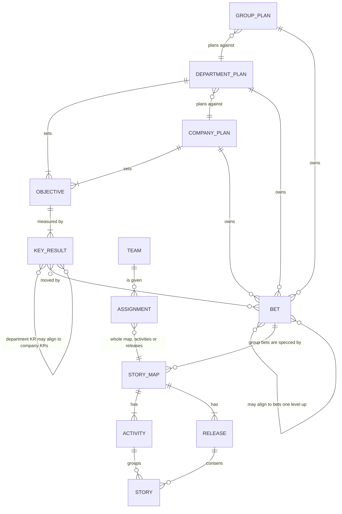

# RFC: plans, bets, story maps and team assignments

**Status:** draft, for review. PR 1 (plan levels) and PR 2 (story maps in group repos) are built. PR 3 (teams) is built as described in "PR 3 status" below, PR 4 (status flowing back) as described in "PR 4 status", and PR 5 (views, editing from the dashboard, editable snapshots and `nikos apply`) as described in "PR 5 status".

## PR 5 status

Built: the three views (OKRs and bets, OKR ladder, and Bets and story maps for a group), editing
from the dashboard for each level through one write path (`src/planning/ops.ts`, behind
`POST /api/op`), the rules the page and the commands share (`src/planning/rules.ts`), saves on a
nikOS branch in a git repo with Commit, Push and Open pull request buttons that each act only on
their own click, the rollout fix, editable snapshots (`nikos planning serve --export <file>
--editable [--with-linked]`), the change file (`schemas/planning/changes.schema.json`) and
`nikos apply <file>` (`src/planning/apply.ts`). The apply path is covered by
`test/planning-apply.test.ts` and the snapshot by `test/planning-export.test.ts`.

Deferred, as decided: objective editing (objectives stay read-only, and key results are grouped by
their objective text), the period picker, activity and step removal (rename only), team status in
rollout (a group's bet under a department bet shows the group's own state, with "team status is not
read here"), and approval gating for planning changes (none: the pull request review is the gate).
The ops for releases, `map new`, `setting set` and `downstream add` exist in `/api/op`, but the
dashboard has no forms for them yet.

Where the build differs from this RFC:

- **Strict is one level up.** `runOp(..., { strict: true })` (used by `/api/op`) first tries the op on
  an in-memory copy and refuses a new validation error before anything is written. The commands
  keep warning only, so `nikos` output is unchanged.
- **Legacy saves are checked first.** `/api/checkin`, `/api/bet` and `/api/review` keep their bodies
  and status codes. Each one is checked as its op (team repo, level, ids, stale expect) before a
  branch is made, then written by the command as before. `/api/bet` still accepts `outcome`.
  `/api/op` refuses it: only a review sets an outcome.
- **`bet krs` is at company and department level,** as the RFC's company row says which key
  results each bet aims at.
- **Teams are named by their repo path.** `assign` and `unassign` take the team's repo path (or `.`) as
  the target. The team's name is an argument, since names like "Checkout web" aren't ids.
- **Renames of activities and steps** refuse with "<id> is not an activity in <map>" and "<id> is not a
  step in <map>".
- **Forge commands.** `gh pr create --base <base> --head <branch> --fill` is checked against the
  installed `gh --help` (gh 2.87.3). `glab` isn't installed where this was built, so
  `glab mr create --source-branch <branch> --target-branch <base> --fill --yes` is not checked
  against a real glab. Without a tool, the command is shown to copy.
- **Commit** stages only the planning, maps and intent paths, and commits only those. Anything else
  that is changed stays unstaged, and the pending bar says so.
- **A failed rollout fetch keeps the last good copy.** The copy is shown with state unreachable and a
  note with the date it was read. A plan that has never been fetched stays unreachable with no copy.
- **Apply always branches**, even from a nikos branch, and never writes unless every check passes
  (the apply report says so). A file's operations chain: a second op on a file may use the hash the
  first one replaced (`runOps` with `chain`).
- **Snapshots carry no team status.** Story status reads "not in this snapshot". Without
  `--with-linked` there are no `upstream` or `downstream` keys at all. Plain `--export` is unchanged.
- **The page checks fields only** (the rules in `rules.ts`, embedded as source). Ids, titles, dates,
  numbers and decisions are checked on the page; the rest is checked by `nikos apply`.
- **Queued changes don't show in the views** of the snapshot they were made in. The views show the
  plan as it was exported, until the changes are applied and the plan is exported again.
- **Review is the only gate.** Nothing waits for an approval before a change is written (D2). A
  pull or merge request is the review, and `nikos apply` names the branch it wrote to.
- **Deferred:** objective editing, activity and step removal, the period picker, team status in
  the snapshot, and forms for release ops and `map new` (they work through `/api/op` and apply).
- **The two OKR views are drawn as linked cards.** OKRs and bets reads left to right: the key
  results above (with their progress and plan), this plan's key results by objective, its bets
  ("Own bet" or "Aligns up"), and the bets above, joined by curved lines. The ladder uses the same
  cards, with the plan's chain in full and the rest faded. The plan and period are shown above the
  view, not picked there.
- **Forge flags.** The `gh pr create` flags are the ones checked against gh's help in part 1. The
  `glab mr create` flags are not checked against a real glab.

Resolved from PR 4: a group bet aligned to a department bet is listed under the department's OKRs
and bets page, as delivery only. `rollout` no longer deletes a plan's last good copy when a fetch fails.

## PR 4 status

Built: `nikos map status` in a group repo (with `--map`, `--offline` and `--json`, and the MCP tool
`map_status`); a group reading each assigned team's `status/` and `approvals/` through a read-only
fetch into `.nikos/teams/`; a bet's delivery counted from those statuses, with the number awaiting
approval and the teams not fetched; `nikos assign` checking a holder's done state in its copy; the
company and group locks reaching a team through `nikos sync`; and the team's `state set` stamping
`spec_hash` on every write. Not in PR 4: the dashboard's editing and the "OKRs and bets" views (PR 5),
`nikos apply` (PR 5), `nikos migrate maps` and the wizard (PR 6), and team repos with `intent/` (PR 6).

Where the build differs from this RFC:

- **Behind is a spec hash, not a sync file.** A team's `state set` stamps `spec_hash` on every write,
  computed from its own copy of the feature. A copy keeps the feature text as it was, so a feature
  changed in the group shows as `behind`, or `changed` for a done story. The group commit isn't
  recorded in the team's repo. A change that only moves a story to another team shows as moved or
  no-status, not behind.
- **Assignments carry `url` and `ref`**, optional, stored only when given. Old CLIs reject a group
  that uses them (the schema is closed), so ship this with the release notes.
- **Shipped needs approval only when it's required.** A done story counts toward a bet when its
  delivery approval holds, or when `approval.policy` is `optional` (the default) or `off`, where no
  approval is needed. Only `required-for-release` holds a done story without an approval as awaiting
  approval, which can move a bet from Shipped back to Building. Releases should say so.
- **Only locks reach a team.** A group's and company's unlocked values don't apply to a team, which
  keeps its own. A group copy that doesn't read is named by `nikos doctor` and skipped.
- **Department rollout doesn't read group teams.** A group's copy under `.nikos/downstream/` has no
  team cache, so its bets keep the group's own numbers and say `team status not read here: run nikos
  map status in <group>`. Aligned group bets under a department bet are listed in PR 5's OKRs and bets view (see "PR 5 status").
- **Intent approvals are read only.** No command writes a group's approval for a team's story yet.
  In `--repo .` the delivery approval and the intent approval share one file, so the group shows it as
  intent only.
- **A move is remembered by the old holder.** The index keeps the team that held a story until the new
  holder has its own status for it, so "moved" and the old team's last status show until then.
- **Cache is per machine.** A new machine shows "previous team not fetched" for moves made elsewhere.
- **`rollout` deleted a plan's last good copy when a fetch failed.** Fixed in PR 5 (see "PR 5 status").

## PR 3 status

## PR 3 status

Built: `nikos team init|join|member|show`, `nikos assign`, `nikos sync`, team-side `next`,
`state set`, `approve`, `show`, `verify` and the tracker, team `validate` and `doctor`, and the
runner paths. (PR 4 added `nikos map status`, the group reading team status, and bets delivered
from it; see "PR 4 status" above.)

Where the build differs from this RFC:

- **`groups:` is a list** in `nikos.team.yaml`, since a team can take work from several groups.
- **`stories:` is a selector** next to `activities:` and `releases:`, so a held part of a map can
  be split by story. Still at most one selector per entry.
- **The team's identity is `repo:`** in `nikos.team.yaml`, and assignments match on that path.
  `--repo .` means the group repo is its own team: its stories are verified in place, with no copy
  and no `status/`. Its state and approvals are the group map's own, so intent and delivery
  approval share one file there.
- **Changing an assignment** records the old team's mark in its committed `status/` file
  (`reassigned_to`, `reassigned_on`), not in the gitignored copy, which is rebuilt each sync.
- **Approval is gated on the code, not the HEAD.** `nikos approve` refuses when code (outside a
  team's own `status/`, `approvals/` and `.nikos/`) has changed since the commit the scenarios ran
  at. Requiring HEAD to equal that commit would refuse every approval made after the status file
  was committed.
- **The runners.** A folder given to behave on the command line replaces the paths in its config.
  So a team repo's `nikos verify` passes its assigned copies (`.nikos/assigned`), and every other
  repo keeps the paths its behave.ini names, as before. The cucumber configs list the new glob in
  `paths`.
- **A team repo can't keep `intent/` or `maps/`** until PR 6 moves them.
- **Team settings are the team's own file, plus the locks of its group and company** (PR 4): a
  group's `nikos.settings.yaml` and `planning/upstream.yaml` are copied by `nikos sync`.

## Summary

nikOS today puts one story map in a repo, beside that repo's plan, and lets
every level (company, department, group, team) set key results. This RFC
proposes the model nikOS should follow instead:

- **OKRs stop at department level.** The company and departments set
  objectives and key results. Lower-level OKRs tend to add noise rather than
  focus.
- **Bets exist at company, department and group level.** Each level's bets are
  its own. A department bet may align to a company bet, and a group bet to a
  department bet, or stand alone.
- **Groups create story maps, one or more per bet.** A story map specs exactly
  one bet. No plan owns a story map directly.
- **Teams are assigned work.** A team gets a whole story map, or specific
  activities or releases of one. Teams have no plan of their own.
- **Teams prove their stories in their own repos.** Each team repo fetches a
  read-only copy of the stories assigned to it, runs their scenarios against
  its code, and reports status back. Nothing is ever written to another repo.

## The model



| Level | Objectives and key results | Bets | Story maps |
| --- | --- | --- | --- |
| Company | Yes | Yes, each aimed at company key results | No |
| Department | Yes. A key result may align to a company one, or be the department's own | Yes. May align to a company bet, or stand alone | No |
| Group | No | Yes. May align to a department bet, or stand alone, and aims at department or company key results | Yes, one or more per bet |
| Team | No | No | No: assigned all or part of a group's story map |

Two rules from today carry over unchanged:

- **Links show alignment, not contribution.** A key result's progress comes only
  from its own check-ins, and a bet's outcome only from its own reviews. Nothing
  adds up from the levels below.
- **Each level is its own repo, and joins the one above it** with `nikos join`.
  Settings and locks are inherited down the chain as they are today.

## What changes from 0.2.4

| Today | Proposed |
| --- | --- |
| Key results at company, department, group and team level | Key results at company and department level only. `nikos planning validate` refuses them in a group plan |
| A bet links only to key results | A bet can also align to one or more bets in the plan directly above |
| One story map per repo, in `intent/` | A group repo holds several story maps, one per bet, under `maps/` |
| Releases name the bets they deliver (`bets:`, `story_bets:`) | The story map names its one bet; releases and stories don't |
| A bet's delivery counts stories in its own repo only | A bet's delivery counts every story map that specs it, with status from the assigned teams' repos |
| The story map and the code are in the same repo | The story map is in the group's repo; the code and the done gate are in each team's repo |
| A team repo has `intent/` and can have its own plan | A team repo has its code and a read-only copy of its assigned stories |

## Storage

### Company and department repos

As today's plan-only repos: `planning/plan.yaml` (`level: company` or
`department`), `planning/krs/`, `planning/bets/`, `planning/decisions.md`,
`planning/upstream.yaml`, `planning/downstream.yaml` and `nikos.settings.yaml`.
No `intent/`.

A bet card gains one optional field:

```yaml
aligns_to: [acme/company-plan#one-tap-pay]   # bets in the plan directly above: none, one or several
```

### Group repos

```
planning/
  plan.yaml                 level: group, period, pillars (no objectives)
  bets/<bet-id>.md          the group's bets, each aimed at department or company key results
  decisions.md
  upstream.yaml             the department plan
maps/
  <map-id>/
    storymap.yaml           bet: <bet-id>, key, activities, steps, releases
    features/               one .feature per story, as today
    plans/                  versioned story plans, as today
    assignments.yaml        which team has which part of the map
    approvals/              intent approvals: the spec, signed off by its owners
```

A department key result's `aligns_to` becomes a list too, so it can align to
several company key results.

A group bet card names key results the way bets do today (`krs.primary`,
`krs.also`), pointing at the department's or company's (`acme/payments-plan#kr-2`).
A group plan has no `krs/` folder.

`assignments.yaml`:

```yaml
- team: Checkout web
  repo: acme/checkout-web
  releases: [1, 2]              # or activities: [pay, confirm], or neither for the whole map
- team: Checkout API
  repo: acme/checkout-api
  activities: [refund]
```

`nikos validate` checks that every story is assigned to at most one team. It
lists the stories nobody has yet.

### Team repos

A team repo is the code, plus:

```
nikos.team.yaml             the team's name and the group repos it takes work from
.nikos/assigned/<group repo>/<map-id>/   read-only copy of the assigned stories (gitignored)
test/steps/                 step definitions, as today
status/<story-id>.yaml      the team's status for each assigned story, with evidence
approvals/<story-id>.yaml   delivery approvals: this spec, at this tested commit
```

`nikos.team.yaml` also says who is in the team:

```yaml
name: Checkout web
group: acme/payments/checkout-group
members:
  - name: Priya Shah
    role: Lead          # free text
    handle: priya-s     # GitHub or GitLab username, optional
```

The team edits its own members, reviewed like any change, and the group reads
them from the team repo. Names, roles and usernames only: no emails or personal
fields, since anyone who can read the repo can read the list. With handles set,
verified approvals can check that an approver is a current member, and `nikos
doctor` can suggest a CODEOWNERS rule for the team's lead. `nikos team member
add`, `remove` and `nikos team show` manage it.

`nikos sync` fetches the assigned stories and records the commit it read, the
same way `nikos planning sync` does for plans. `nikos verify` runs the copied
features against the team's own step definitions and code. `nikos state set`
writes `status/`, and the done gate works exactly as it does today.

## How status flows back

Nothing is written across repos. The group repo reads its teams' repos:

1. `nikos map status` in the group repo fetches each assigned team repo
   read-only, as `nikos planning rollout` does. For each story, it reads the
   team's `status/` and `approvals/`.
2. A story's status is the team's status, as long as the team proved it against
   the story's current feature (`spec_hash`) and the team's copy isn't behind.
   Otherwise it shows as changed or behind, with what to do.
3. A bet's delivery (Shipped, Building, Not started) is worked out from every
   story map that specs it. A department bet's delivery can show the group bets
   aligned to it, as delivery only. Its outcome is still its own.

Approvals split by what they sign off:

- **Intent approval**, in the group repo: the story's spec, signed off by its
  owners.
- **Delivery approval**, in the team repo: this spec, at this tested commit,
  with this evidence.

The verified-approvals RFC applies to both.

## Commands (proposed)

| Where | Command | What it does |
| --- | --- | --- |
| Company | `nikos company init` | As today |
| Department | `nikos company init --level department` | A department plan with no story map (PR #71) |
| Group | `nikos group init` | A group plan: bets, no key results, `maps/` |
| Group | `nikos map new --bet <bet-id> --key <KEY>` | A story map for one bet |
| Group | `nikos assign "<team>" --repo <path> [--activities a,b \| --releases 1,2]` | Assign a team all or part of a map |
| Group | `nikos map status` | Fetch the team repos and show each story's status |
| Team | `nikos team init` / `nikos team join <group repo>` | Make a code repo a team repo, and take work from a group |
| Team | `nikos sync` | Fetch the assigned stories |
| Team | `nikos next`, `verify`, `state set`, `approve` | As today, on the assigned stories |

Today's story map commands (`story add`, `release add`, `clear`, `show` and the
rest) run in the group repo. They take `--map <map-id>` when there's more than
one map, and work without it when there's one.

## Views

Each company and department plan gets two views for a chosen period, read left
to right:

- **OKRs and bets:** the key results above that this plan's align to, this
  plan's key results grouped by objective, its bets, and the bets above they
  align to. Bets are marked as aligned or the plan's own.
- **OKR ladder:** company and department key results in two columns, with the
  chosen plan's chain highlighted.

A group plan gets:

- **Bets and story maps:** each bet, the department bet it aligns to, its story
  maps, the teams assigned to each part, and each story's status from those
  teams.

These replace today's Rollout tab and alignment tree. Links stay links: no view
adds up progress.

### Managing from the dashboard

The dashboard (`nikos serve`) becomes the easiest way for each level to manage
its own part of the hierarchy, without the command line. Today it can already
save check-ins, bets and bet reviews. It would cover:

| Level | What it can change in the dashboard |
| --- | --- |
| Company | Objectives, key results and check-ins; bets and their reviews; which key results each bet aims at; the departments listed below; the approval settings it hands down |
| Department | The same for its own plan, plus aligning a key result to a company key result and a bet to a company bet, picked from the synced copy of the company plan |
| Group | Bets and reviews; aligning a bet to a department bet; creating a story map for a bet; activities, steps, releases and story titles (scenarios are left to the agent); assigning teams to a whole map, activities or releases |

Rules that keep it safe:

- **It only writes to its own repo.** A department aligns its key result to a
  company one by writing a reference in its own repo, never by editing the
  company's. Plans above and below are shown from read-only copies.
- **Every save goes through the same commands and checks** as the CLI, so a
  save the CLI would refuse is refused with the same message.
- **Changes are commits a person reviews.** Saves land on a branch, and the
  dashboard shows the pending changes and offers to commit them and open a pull
  or merge request. Planning changes get reviewed the same way code does, and
  approval rules apply.
- **It runs locally**, with the person's own git access, as today. It stays a
  local, single-person tool. A hosted, always-on, multi-person editing service
  is out of scope for nikOS.

### For people who don't use git

Someone who doesn't use git can still do their part, with a git user bringing
it in:

1. **A git user sends them an editable snapshot.** `nikos serve --export
   plan.html --editable` writes the dashboard as one HTML file, as
   `--export` does today, with editing switched on. It records the commit it
   was made from. By default it contains only this level's own plan, so it can't
   leak other plans; `--with-linked` adds the read-only copies the dashboard
   shows, for people allowed to see them.
2. **They edit in their browser.** They open the file, with no install and no
   network. They make their changes (a check-in, a new key result, a bet
   review), and the same checks run in the page as in the CLI. Then they choose
   **Download changes**.
3. **They get a change file.** `<plan>-changes-<date>.nikos.json` lists each
   change as an operation, such as "check in kr-2: 44 on 2027-01-20, evidence
   …", not as raw file edits. It also records who made the changes (as they
   typed it) and the commit the snapshot came from.
4. **A git user applies it.** `nikos apply <file>` makes a branch and applies
   each operation through the same commands. It runs validation and shows what
   changed, then offers to commit and open a pull or merge request. If the plan
   has moved on since the snapshot, each operation is checked against the
   current files. One that no longer applies (say, a check-in on a key result
   that was since removed) is listed with the reason, and the rest still apply.

The change file holds no credentials and does nothing on its own: it only
takes effect when a git user applies it and the change is merged, so
review and approval rules still hold. The name typed in the browser is
attribution, not verified identity (see `verified-approvals.md`).

In the dashboard, story editing stops at structure: titles, activities, steps,
releases and assignments. Gherkin scenarios are left to the agent, which writes
them, checks them with CLEAR and asks for approval.

An editable snapshot holds only this level's own plan by default. Plans above
and below, which the dashboard shows from read-only copies, are left out unless
the git user asks for them with `--with-linked`. Links to them still show as
references, so a department can still see which company key result its own
aligns to.

## The smallest setup

A small company may have one department, one group and one team. That's four
repos, which is heavy for a start. Two shortcuts keep the model without the
weight:

- A group repo can also be its team's code repo: assign the team with
  `--repo .`, and its stories are verified in place.
- A company plan can list groups directly when there are no departments. The
  group's bets then align to company bets.

## Migration from 0.2.x

- **A repo with `intent/` and code:** `nikos migrate maps` moves `intent/` into
  `maps/<key>/`, asks which bet the map specs, and assigns the repo's own team
  with `--repo .`. Releases' `bets:` and `story_bets:` become the map's `bet`,
  or stay as a warning when they named several.
- **Key results in group or team plans:** `nikos planning validate` warns and
  suggests moving each one to the department, or rewriting it as a bet aimed at
  a department key result. Nothing is deleted.
- **A team plan** (from the 0.2.4 wizard): flagged by `nikos doctor`, with the
  same suggestion.
- `nikos doctor` explains each step, and every migration is a commit the person
  reviews.

## PR #71

#71 keeps the right first question (company, department or team) and adds
`--level department`. Its team option, a story map beside a team plan, is what
this RFC replaces. Proposed: close #71 unmerged, and carry `--level department`
and the three-way question (company, department or group, with team setup
separate) into the first implementation PR.

## Decisions

1. **Several parents.** A bet can align to one or more bets in the plan directly
   above, and a department key result to one or more company key results.
   `aligns_to` is a list. The views draw a line to each.
2. **Story ids are unique across the company.** Every story id carries the
   group's key and the map's key: `<GROUP>-<MAP>-<n>`, for example
   `PAY-CHK-12`. A group's key is chosen at `nikos group init` and checked
   unique across the company when the group joins, the way `nikos join`
   checks the plan above today. A map's key is unique within its group. Ids stay
   readable and never collide. From another repo, a story is still referred to
   as `<repo>#<id>`.
3. **Trackers connect per team.** Each team repo has its own tracker settings
   and ticket links, and the company can still lock `tracker.system` for
   everyone. The group sees each story's ticket through the team's `status/`.
4. **Changing an assignment:**
   - **Done and approved stories don't move.** They stay with the team that
     delivered them, with its status, evidence and delivery approval. An
     assignment change only covers unfinished work. `nikos assign` refuses to
     move a done story unless told to with `--include-done`, and then the new
     team starts it at todo.
   - **Unfinished stories start fresh with the new team.** The new team's copy
     has the story at todo. The old team's next `nikos sync` marks its entry
     "reassigned to <team>", keeps it as history, and drops it from
     `nikos next`. Work in progress isn't lost: the old team's branch and notes
     stay in its repo, and `nikos map status` shows the story as moved, with
     the old team's last status.
   - **Approvals:** intent approvals live with the spec in the group repo, so
     they hold through a move. Delivery approvals are bound to a team's tested
     commit, so they never transfer: the new team proves the story and is
     approved again.
5. **Step definitions live in each team's repo.** A step drives
   that team's code, so it belongs beside the code, not with the map in the
   group repo, which has no code. When two teams' stories share a step phrase,
   each team writes its own definition, because it tests a different system. If
   two teams share a codebase, they can share steps as an ordinary package
   (npm, pip), which nikOS doesn't need to know about. `nikos verify` lists any
   step in the team's assigned stories that has no definition yet.

## Not in scope

- Verified approver identity: see `verified-approvals.md`.
- Notes, research and asset links: see `knowledge-assets.md`.
- Team structures from an HR system: see `team-structure.md`.
