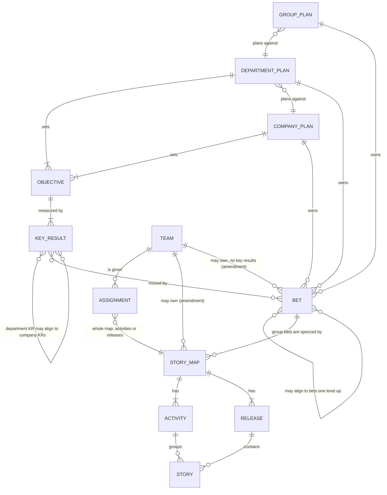

# RFC: plans, bets, story maps and team assignments

**Status:** draft, for review. PR 1 (plan levels) and PR 2 (story maps in group repos) are built. PR 3 (teams) is built as described in "PR 3 status" below, PR 4 (status flowing back) as described in "PR 4 status", PR 5 (views, editing from the dashboard, editable snapshots and `nikos apply`) as described in "PR 5 status", and PR 6 (migration and onboarding) as described in "PR 6 status".

## Amendment: teams that own a story map (after 0.3.0)

**Status:** design only, for review. Nothing here is built yet.

A team can own story maps itself, as well as being assigned parts of a
group's. It doesn't need a group or department above it. Teams stay
plan-free: they never have objectives or key results, and `nikos planning kr
new` in a team repo is refused with the same "Key results stop at department
level" message a group gets.

### What a team may hold

A team can own several story maps. Each one specs exactly one bet, like any
map. That bet is one of:

- **a company, department or group bet**, named directly from the team's map:
  `bet: acme/company-plan#one-inbox`; or
- **a bet of the team's own**, in the team repo's `planning/bets/`, aimed at
  company or department key results (`krs: acme/company-plan#close-days`),
  and optionally aligned to company, department or group bets.

A team repo with its own maps looks like this:

```
nikos.team.yaml             name, key (new: key: WEB), home (new), members, groups
planning/upstream.yaml      every plan the team plans against, at any level
planning/bets/<id>.md       the team's own bets, if any: no objectives, no key results
maps/<key>/                 each map the team owns, verified in place
.nikos/assigned/...         maps assigned by groups, as today
status/ approvals/          as today, for both kinds
```

### Rules

1. **One home, many plans.** A team is homed in exactly one plan: a specific
   group, department or company (`home: acme/payments-plan` in
   `nikos.team.yaml`). Its home plan lists it in `planning/downstream.yaml`,
   and settings and locks reach the team down its home's chain only. Beyond
   its home, a team can take part in several plans at any level: it joins
   each one (`nikos join`, listed in `planning/upstream.yaml`) and its maps and
   bets may align to bets and key results in any plan it has joined. It still
   takes work from groups, as today.
2. **Story ids stay company-unique.** A team-owned map's ids carry the team's
   key and the map's key: `WEB-INB-1`. A team's key is chosen at `nikos team
   init --key` and checked unique across the company when the team joins its
   home. Groups' and teams' keys share one set of names. A map's key is unique
   within its team.
3. **A team's own maps are in place.** Their status and approvals are the
   team's own files, so they are committed and travel with the team repo.
   There is no `.nikos/assigned` copy and no `nikos map status` fetch for them.
4. **Every plan a team joined lists it.** The home plan lists the team in
   `planning/downstream.yaml` as usual. A plan the team joined but isn't homed
   in lists it too, marked `home: <repo>`, so that plan knows where to fetch
   the team from. Its rollout shows which of the team's maps and bets align
   to its bets and key results, and the delivery of those maps, read from the
   team's committed status. Settings and locks still come only from the home.
5. **Groups have one home and many plans too.** "The smallest setup" already
   says a group can align to company bets when there are no departments.
   0.3.0 refuses that (a group bet must align to a department). The rule
   becomes the team's rule 1: a group is homed in one company or department
   plan, where its settings and locks come from, and can join other plans at
   any level above it. Its bets may align to bets in any plan it has joined,
   and aim at key results in any of them. Every plan it joins lists it.
6. **Migration.** `nikos migrate maps` refuses a team repo with `intent/` today.
   With this amendment it can move `intent/` to the team's own `maps/<key>/`
   in place, asking for the team key, its home and the bet.

7. **Another team can be given stories from a team's map, and the map never
   moves.** The group decides who builds what. The decision is recorded beside
   the map, in team A's `maps/<key>/assignments.yaml`. Team A holds its own
   share there as `--repo .`, and team B's share is named the way a group
   names a team. A CODEOWNERS rule on that file asks the group's lead to
   review every change, so team A can't hand out work alone. Team B learns of
   its stories the way it would from a group: `nikos team join <team A repo>`,
   then `nikos sync`, which fetches a read-only copy into `.nikos/assigned/`.
   Team B's status and approvals stay in team B's repo, and team A's `nikos
   map status` reads them, as a group's does. Story ids never change
   (`WEB-INB-1`), whoever builds the story.
8. **A team's own bets aim at company or department key results.** Groups
   have no key results, so a team's bet that relates to a group's work
   aligns to the group's bet instead.
9. **Delivery reaches the plans above through a committed summary.** In
   0.3.0, `nikos map status` keeps what it reads from teams in `.nikos/`, which
   is gitignored, so a department's or company's rollout never sees team
   delivery and prints "0 of 2 done". Instead, `nikos map status` writes a
   dated summary beside each map it reads (`maps/<key>/delivery.yaml`: per
   story, the team, status, freshness and approval, and when it was read). The
   map's owner commits it like any other file, and every rollout above reads
   it, saying how old it is. This covers a group's maps, a team's own maps,
   and stories another team builds from a team's map. A rollout never fetches
   team repos itself.
10. **A stopped bet doesn't stop the bets aimed at it.** Each level owns its
    bets, so stopping a department bet leaves a group or team bet aligned to
    it open. The rollout and the views flag it: "aligns to manual-queue, which
    was stopped on <date>", so the owner can review it.
11. **Approvals name a person, not a verified identity.** An approval records
    who approved it (the git name, or the name given in chat) until the
    verified-approvals RFC is built. Nothing presents that name as checked by
    the forge.

### Amendment status

**Status:** partly built, for review. The 0.3.0 fixes, the level rules, the delivery summary, the stopped-parent flag, the team key and home, and the home's settings chain are built. Team-owned story maps and team sync sources are not yet.

Built, as the amendment says:

- Rules 4 and 10: the rollout flags a bet aimed at a stopped bet, with the stop date. Nothing cascades.
- Rule 5 and section 3: a plan aligns to any plan above it that it joins, and `krs:` cross-references are checked. A company bet still has nothing above it. `planning kr new` in a team repo is refused with the key-result wording.
- Rule 9: `nikos map status` writes `maps/<key>/delivery.yaml`, and every rollout reads it, saying how old it is, including the bet lines. A rollout never fetches a team repo for its delivery. The "0 of 0" and "team status not read here" text is gone. `--json` writes nothing.
- Rule 10 and section 8: the stopped-parent flag covers the plan's own stopped bets as well as the plans below, and the OKRs and bets page and the group bets list show it.
- Rule 1 (in part): `nikos join <plan> --home` sets a team's home in nikos.team.yaml (format 2), checks it is a group, department or company plan whose key isn't the team's, and refuses a second home. A group's `--home` marks its home in planning/upstream.yaml. A team's settings and locks come only from its home's chain. A team repo with no key, home or maps is refused as in 0.3.0.
- Rule 11: no output puts "verified" beside an approver. This is checked by a test over the source.
- Team key (D6, in part): `nikos team init --key` and the `key` field. A keyless team keeps format 1.
- Team home (D3, in part): the `home` field is written by `nikos join --home` and read by the team's settings chain. `nikos doctor` warns about a team that joins a plan without one.

Where the build differs:

- **Rule 9 wording.** The amendment says "a rollout never fetches team repos". That holds for delivery. Rollouts still fetch the plans below through their downstream.yaml (as before), and they never read a team's live `status/` or `approvals/`. Rule 9 should say so; this is decision D2, and it is not changed here.
- **Delivery reads the owner's summary, not the team.** A copy's bet and rollout count the owner's `delivery.yaml`. A story the summary doesn't list counts as "no summary yet" (not done). A map with no teams counts its own state.
- **Summary owner.** `delivery.yaml` is written only when the repo has an origin remote (its repo path is the owner). With no origin, `nikos map status` says so and writes nothing.
- **Approver names.** A summary records the name the approval was given (`approved_by`), and nothing else.
- **Legacy team plans.** A 0.3.0 plan whose `plan.yaml` says `level: team` keeps its old, unchecked links. The new rules apply to team repos (no `plan.yaml`).

Not built yet (the amendment's rules 2, 3, 6, 7 and the sections below them):

- Team-owned maps: `maps/<key>/` in a team repo, its ids (`WEB-INB-n`), `map new`, `story add`, the `validate`/`doctor` checks for them, and the guards that would allow them (`storyMapClash` still refuses `maps/` in a team repo, so `map status` also refuses a team repo).
- Team sync sources: `nikos sync` still reads only groups, so a team can't take stories from another team's map, and `nikos team join <team repo>` is refused.
- `nikos assign` and `migrate maps` for a team's own map, and the CODEOWNERS suggestion and lead handle (D4).
- The key-collision check across the whole home chain (D5). Only the team's key against the plan it joins is checked.
- The playbooks, skills and MCP descriptions for team layouts, and an end-to-end test of the whole flow (`team-e2e-amendment`).

### Decided in review

- Group key results: none. A team's bet aims at company or department key
  results, and may align to a group bet (rule 8).
- A plan the team joined but isn't homed in lists the team (rule 4).
- Stories on a team's map can be given to another team. The group decides, the assignment sits beside the map in the team's repo, and the map never moves (rule 7).
- A group, like a team, can join many plans, homed in one (rule 5).
- Delivery travels up as a committed summary written by `nikos map status` (rule 9).
- A stopped bet leaves the bets aimed at it open, and the rollout flags them (rule 10).
- Approvals stay names until verified approvals are built (rule 11).

## PR 6 status

Built: `nikos migrate maps` (`src/commands/migrate-maps.ts`), which moves a 0.2.x `intent/` into
`maps/<key>/` of a group that is its own team. It shows the whole plan first, checks the new layout
on a copy of the repo (`validateGroup` and the planning checks), and writes only after a yes (or
`--yes`). The changes stay uncommitted on `nikos/migrate-maps`, or are committed with `--commit`,
which commits only the paths it wrote. It never pushes. Also built: the `nikos doctor` hints for
0.2.x repos (the layout, a team plan, a runner that doesn't run the story folder), the onboarding
wizard's six choices (company, department, group, team repo, product, both), `nikos start`
refusing a repo with `maps/`, the behave template's header, the playbooks, and the MCP
descriptions. Tests: `test/migrate-maps.test.ts`, `test/migrate-doctor.test.ts`, and the wizard
cases in `test/first-run.test.ts`.

Review fixes on top of that build: a failed write or check puts the repo back (snapshot, then restore, and the new branch is deleted when this run made it); the plan is printed before the "Write these changes?" question and before any write; an intent/ file the moves don't pick up stops the migration in preflight (only `.gitkeep` and Finder or Explorer files are removed, and each is listed in the plan); nested state and approvals keep their folder; a release that names a bet with no card is refused with `--new-bet` named (or offered as a stub in a terminal); a flag that disagrees with the plan's period or name is refused; unknown `--options` are a usage error; `nikos verify setup` in a group repo writes the maps' folders into behave.ini; team doctor warns when the runner has no folder of step definitions.

Where the build differs from this RFC:

- **Story ids are renamed only with `--rename-ids`.** Keeping `HT-1` in `maps/` isn't possible:
  validation requires `<GROUP>-<MAP>-<n>` there, and the RFC's keep-the-ids path would need a schema
  change, which was rejected. So a migration whose ids lack the group key stops, and lists them.
  `--rename-ids` renames `KEY-n` to `GROUP-KEY-n`, rewrites tags above `Feature:` and the state,
  approval and plan files, and leaves body text alone (a changed body would change the spec hash
  and lapse the approval). The plan lists the other files that mention a renamed id.
- **Group key results stay an error.** `nikos planning validate` keeps refusing key results in a
  group plan. The RFC's migration section said "warns"; that's amended here. A team plan with key
  results or objectives is refused by the migration, with what to do.
- **Bet links are dropped, and listed.** Validation refuses `bets:` and `story_bets:` in a map, so
  the map's bet is the one the releases name (or `--bet`, or `--new-bet` for a stub). Other links and
  cross-repo links are listed in the plan, for the person to add to the bet's card by hand.
- **Team repos with `intent/` are refused, not moved.** A team repo can't hold a story map, so the
  refusal says to move `intent/` into a group repo and then join.
- **Doctor hints are warnings, and fold into existing checks for intent/ repos.** The layout hint
  and the team-plan hint are the story map check's `next`, and the runner check warns only when a
  config lists paths without the story folder. This keeps the check names that repos already see.
  A team plan in a team repo is a `plan` warning.
- **Changes are uncommitted by default.** `--commit` commits the migration alone.
- **behave takes folders, not globs.** A group's behave.ini lists each map's `features` folder, as a multi-line `paths =`. A review run with behave 1.3.3 found that form accepted; it was not re-run for this PR, and a single `maps` folder is the alternative, not used here.
- **Not checked here:** the python undefined-steps listing is parsed from behave's JSON, but no python run was made against a real behave install in this PR.
- **Wizard choices renumber.** The menu is 1 company, 2 department, 3 group, 4 team repo, 5 product,
  6 both. Typed `team` is still a product, as before. Scripts that pipe answers break; flags don't.
- **The smallest setup's company case isn't special-cased.** A group with no department plans
  against the company's key results with `krs:`, and the alignment rule keeps a group's bet
  aligned to the plan directly above it, so a group with no department has no bet alignment to
  the company. The wizard only lists groups directly under a company plan, and writes no alignment.
- **Not in PR 6:** the PR 5 deferrals, and `migrate maps` is not exposed through MCP (it writes
  files a person reviews first).

## PR 5 status

Built: the three views (OKRs and bets, OKR ladder, and Bets and story maps for a group), editing
from the dashboard for each level through one write path (`src/planning/ops.ts`, behind
`POST /api/op`), the rules the page and the commands share (`src/planning/rules.ts`), saves on a
nikOS branch in a git repo with Commit, Push and Open pull request buttons that each act only on
their own click, the rollout fix, editable snapshots (`nikos planning serve --export <file>
--editable [--with-linked]`), the change file (`schemas/planning/changes.schema.json`) and
`nikos apply <file>` (`src/planning/apply.ts`). The apply path is covered by
`test/planning-apply.test.ts` and the snapshot by `test/planning-export.test.ts`.

Deferred, as decided: objective editing (objectives stay read-only, and key results are grouped by
their objective text), the period picker, activity and step removal (rename only), team status in
rollout (a group's bet under a department bet shows the group's own state, with "team status is not
read here"), and approval gating for planning changes (none: the pull request review is the gate).
The ops for releases, `map new`, `setting set` and `downstream add` exist in `/api/op`, but the
dashboard has no forms for them yet.

Where the build differs from this RFC:

- **Strict is one level up.** `runOp(..., { strict: true })` (used by `/api/op`) first tries the op on
  an in-memory copy and refuses a new validation error before anything is written. The commands
  keep warning only, so `nikos` output is unchanged.
- **Legacy saves are checked first.** `/api/checkin`, `/api/bet` and `/api/review` keep their bodies
  and status codes. Each one is checked as its op (team repo, level, ids, stale expect) before a
  branch is made, then written by the command as before. `/api/bet` still accepts `outcome`.
  `/api/op` refuses it: only a review sets an outcome.
- **`bet krs` is at company and department level,** as the RFC's company row says which key
  results each bet aims at.
- **Teams are named by their repo path.** `assign` and `unassign` take the team's repo path (or `.`) as
  the target. The team's name is an argument, since names like "Checkout web" aren't ids.
- **Renames of activities and steps** refuse with "<id> is not an activity in <map>" and "<id> is not a
  step in <map>".
- **Forge commands.** `gh pr create --base <base> --head <branch> --fill` is checked against the
  installed `gh --help` (gh 2.87.3). `glab` isn't installed where this was built, so
  `glab mr create --source-branch <branch> --target-branch <base> --fill --yes` is not checked
  against a real glab. Without a tool, the command is shown to copy.
- **Commit** stages only the planning, maps and intent paths, and commits only those. Anything else
  that is changed stays unstaged, and the pending bar says so.
- **A failed rollout fetch keeps the last good copy.** The copy is shown with state unreachable and a
  note with the date it was read. A plan that has never been fetched stays unreachable with no copy.
- **Apply always branches**, even from a nikos branch, and never writes unless every check passes
  (the apply report says so). A file's operations chain: a second op on a file may use the hash the
  first one replaced (`runOps` with `chain`).
- **Snapshots carry no team status.** Story status reads "not in this snapshot". Without
  `--with-linked` there are no `upstream` or `downstream` keys at all. Plain `--export` is unchanged.
- **The page checks fields only** (the rules in `rules.ts`, embedded as source). Ids, titles, dates,
  numbers and decisions are checked on the page; the rest is checked by `nikos apply`.
- **Queued changes don't show in the views** of the snapshot they were made in. The views show the
  plan as it was exported, until the changes are applied and the plan is exported again.
- **Review is the only gate.** Nothing waits for an approval before a change is written (D2). A
  pull or merge request is the review, and `nikos apply` names the branch it wrote to.
- **Deferred:** objective editing, activity and step removal, the period picker, team status in
  the snapshot, and forms for release ops and `map new` (they work through `/api/op` and apply).
- **The two OKR views are drawn as linked cards.** OKRs and bets reads left to right: the key
  results above (with their progress and plan), this plan's key results by objective, its bets
  ("Own bet" or "Aligns up"), and the bets above, joined by curved lines. The ladder uses the same
  cards, with the plan's chain in full and the rest faded. The plan and period are shown above the
  view, not picked there.
- **Forge flags.** The `gh pr create` flags are the ones checked against gh's help in part 1. The
  `glab mr create` flags are not checked against a real glab.

Resolved from PR 4: a group bet aligned to a department bet is listed under the department's OKRs
and bets page, as delivery only. `rollout` no longer deletes a plan's last good copy when a fetch fails.

## PR 4 status

Built: `nikos map status` in a group repo (with `--map`, `--offline` and `--json`, and the MCP tool
`map_status`); a group reading each assigned team's `status/` and `approvals/` through a read-only
fetch into `.nikos/teams/`; a bet's delivery counted from those statuses, with the number awaiting
approval and the teams not fetched; `nikos assign` checking a holder's done state in its copy; the
company and group locks reaching a team through `nikos sync`; and the team's `state set` stamping
`spec_hash` on every write. Not in PR 4: the dashboard's editing and the "OKRs and bets" views (PR 5),
`nikos apply` (PR 5), `nikos migrate maps` and the wizard (PR 6), and team repos with `intent/` (PR 6).

Where the build differs from this RFC:

- **Behind is a spec hash, not a sync file.** A team's `state set` stamps `spec_hash` on every write,
  computed from its own copy of the feature. A copy keeps the feature text as it was, so a feature
  changed in the group shows as `behind`, or `changed` for a done story. The group commit isn't
  recorded in the team's repo. A change that only moves a story to another team shows as moved or
  no-status, not behind.
- **Assignments carry `url` and `ref`**, optional, stored only when given. Old CLIs reject a group
  that uses them (the schema is closed), so ship this with the release notes.
- **Shipped needs approval only when it's required.** A done story counts toward a bet when its
  delivery approval holds, or when `approval.policy` is `optional` (the default) or `off`, where no
  approval is needed. Only `required-for-release` holds a done story without an approval as awaiting
  approval, which can move a bet from Shipped back to Building. Releases should say so.
- **Only locks reach a team.** A group's and company's unlocked values don't apply to a team, which
  keeps its own. A group copy that doesn't read is named by `nikos doctor` and skipped.
- **Department rollout doesn't read group teams.** A group's copy under `.nikos/downstream/` has no
  team cache, so its bets keep the group's own numbers and say `team status not read here: run nikos
  map status in <group>`. Aligned group bets under a department bet are listed in PR 5's OKRs and bets view (see "PR 5 status").
- **Intent approvals are read only.** No command writes a group's approval for a team's story yet.
  In `--repo .` the delivery approval and the intent approval share one file, so the group shows it as
  intent only.
- **A move is remembered by the old holder.** The index keeps the team that held a story until the new
  holder has its own status for it, so "moved" and the old team's last status show until then.
- **Cache is per machine.** A new machine shows "previous team not fetched" for moves made elsewhere.
- **`rollout` deleted a plan's last good copy when a fetch failed.** Fixed in PR 5 (see "PR 5 status").

## PR 3 status

Built: `nikos team init|join|member|show`, `nikos assign`, `nikos sync`, team-side `next`,
`state set`, `approve`, `show`, `verify` and the tracker, team `validate` and `doctor`, and the
runner paths. (PR 4 added `nikos map status`, the group reading team status, and bets delivered
from it; see "PR 4 status" above.)

Where the build differs from this RFC:

- **`groups:` is a list** in `nikos.team.yaml`, since a team can take work from several groups.
- **`stories:` is a selector** next to `activities:` and `releases:`, so a held part of a map can
  be split by story. Still at most one selector per entry.
- **The team's identity is `repo:`** in `nikos.team.yaml`, and assignments match on that path.
  `--repo .` means the group repo is its own team: its stories are verified in place, with no copy
  and no `status/`. Its state and approvals are the group map's own, so intent and delivery
  approval share one file there.
- **Changing an assignment** records the old team's mark in its committed `status/` file
  (`reassigned_to`, `reassigned_on`), not in the gitignored copy, which is rebuilt each sync.
- **Approval is gated on the code, not the HEAD.** `nikos approve` refuses when code (outside a
  team's own `status/`, `approvals/` and `.nikos/`) has changed since the commit the scenarios ran
  at. Requiring HEAD to equal that commit would refuse every approval made after the status file
  was committed.
- **The runners.** A folder given to behave on the command line replaces the paths in its config.
  So a team repo's `nikos verify` passes its assigned copies (`.nikos/assigned`), and every other
  repo keeps the paths its behave.ini names, as before. The cucumber configs list the new glob in
  `paths`.
- **A team repo can't keep `intent/` or `maps/`** until PR 6 moves them.
- **Team settings are the team's own file, plus the locks of its group and company** (PR 4): a
  group's `nikos.settings.yaml` and `planning/upstream.yaml` are copied by `nikos sync`.

## Summary

nikOS today puts one story map in a repo, beside that repo's plan, and lets
every level (company, department, group, team) set key results. This RFC
proposes the model nikOS should follow instead:

- **OKRs stop at department level.** The company and departments set
  objectives and key results. Lower-level OKRs tend to add noise rather than
  focus.
- **Bets exist at company, department and group level.** Each level's bets are
  its own. A department bet may align to a company bet, and a group bet to a
  department bet, or stand alone.
- **Groups create story maps, one or more per bet.** A story map specs exactly
  one bet. No plan owns a story map directly.
- **Teams are assigned work.** A team gets a whole story map, or specific
  activities or releases of one. Teams have no objectives or key results.
  Since the amendment above, a team may also own story maps for company,
  department or group bets, or for bets of its own.
- **Teams prove their stories in their own repos.** Each team repo fetches a
  read-only copy of the stories assigned to it, runs their scenarios against
  its code, and reports status back. Nothing is ever written to another repo.

## The model



| Level | Objectives and key results | Bets | Story maps |
| --- | --- | --- | --- |
| Company | Yes | Yes, each aimed at company key results | No |
| Department | Yes. A key result may align to a company one, or be the department's own | Yes. May align to a company bet, or stand alone | No |
| Group | No | Yes. May align to a department bet, or stand alone, and aims at department or company key results | Yes, one or more per bet |
| Team | No | Since the amendment: its own, aimed at company or department key results | Assigned all or part of a group's map. Since the amendment, may also own several maps, each for a company, department, group or own bet |

Two rules from today carry over unchanged:

- **Links show alignment, not contribution.** A key result's progress comes only
  from its own check-ins, and a bet's outcome only from its own reviews. Nothing
  adds up from the levels below.
- **Each level is its own repo, and joins the one above it** with `nikos join`.
  Settings and locks are inherited down the chain as they are today.

## What changes from 0.2.4

| Today | Proposed |
| --- | --- |
| Key results at company, department, group and team level | Key results at company and department level only. `nikos planning validate` refuses them in a group plan |
| A bet links only to key results | A bet can also align to one or more bets in the plan directly above |
| One story map per repo, in `intent/` | A group repo holds several story maps, one per bet, under `maps/` |
| Releases name the bets they deliver (`bets:`, `story_bets:`) | The story map names its one bet; releases and stories don't |
| A bet's delivery counts stories in its own repo only | A bet's delivery counts every story map that specs it, with status from the assigned teams' repos |
| The story map and the code are in the same repo | The story map is in the group's repo; the code and the done gate are in each team's repo |
| A team repo has `intent/` and can have its own plan | A team repo has its code and a read-only copy of its assigned stories |

## Storage

### Company and department repos

As today's plan-only repos: `planning/plan.yaml` (`level: company` or
`department`), `planning/krs/`, `planning/bets/`, `planning/decisions.md`,
`planning/upstream.yaml`, `planning/downstream.yaml` and `nikos.settings.yaml`.
No `intent/`.

A bet card gains one optional field:

```yaml
aligns_to: [acme/company-plan#one-tap-pay]   # bets in the plan directly above: none, one or several
```

### Group repos

```
planning/
  plan.yaml                 level: group, period, pillars (no objectives)
  bets/<bet-id>.md          the group's bets, each aimed at department or company key results
  decisions.md
  upstream.yaml             the department plan
maps/
  <map-id>/
    storymap.yaml           bet: <bet-id>, key, activities, steps, releases
    features/               one .feature per story, as today
    plans/                  versioned story plans, as today
    assignments.yaml        which team has which part of the map
    approvals/              intent approvals: the spec, signed off by its owners
```

A department key result's `aligns_to` becomes a list too, so it can align to
several company key results.

A group bet card names key results the way bets do today (`krs.primary`,
`krs.also`), pointing at the department's or company's (`acme/payments-plan#kr-2`).
A group plan has no `krs/` folder.

`assignments.yaml`:

```yaml
- team: Checkout web
  repo: acme/checkout-web
  releases: [1, 2]              # or activities: [pay, confirm], or neither for the whole map
- team: Checkout API
  repo: acme/checkout-api
  activities: [refund]
```

`nikos validate` checks that every story is assigned to at most one team. It
lists the stories nobody has yet.

### Team repos

A team repo is the code, plus:

```
nikos.team.yaml             the team's name and the group repos it takes work from
.nikos/assigned/<group repo>/<map-id>/   read-only copy of the assigned stories (gitignored)
test/steps/                 step definitions, as today
status/<story-id>.yaml      the team's status for each assigned story, with evidence
approvals/<story-id>.yaml   delivery approvals: this spec, at this tested commit
```

`nikos.team.yaml` also says who is in the team:

```yaml
name: Checkout web
group: acme/payments/checkout-group
members:
  - name: Priya Shah
    role: Lead          # free text
    handle: priya-s     # GitHub or GitLab username, optional
```

The team edits its own members, reviewed like any change, and the group reads
them from the team repo. Names, roles and usernames only: no emails or personal
fields, since anyone who can read the repo can read the list. With handles set,
verified approvals can check that an approver is a current member, and `nikos
doctor` can suggest a CODEOWNERS rule for the team's lead. `nikos team member
add`, `remove` and `nikos team show` manage it.

`nikos sync` fetches the assigned stories and records the commit it read, the
same way `nikos planning sync` does for plans. `nikos verify` runs the copied
features against the team's own step definitions and code. `nikos state set`
writes `status/`, and the done gate works exactly as it does today.

## How status flows back

Nothing is written across repos. The group repo reads its teams' repos:

1. `nikos map status` in the group repo fetches each assigned team repo
   read-only, as `nikos planning rollout` does. For each story, it reads the
   team's `status/` and `approvals/`.
2. A story's status is the team's status, as long as the team proved it against
   the story's current feature (`spec_hash`) and the team's copy isn't behind.
   Otherwise it shows as changed or behind, with what to do.
3. A bet's delivery (Shipped, Building, Not started) is worked out from every
   story map that specs it. A department bet's delivery can show the group bets
   aligned to it, as delivery only. Its outcome is still its own.

Approvals split by what they sign off:

- **Intent approval**, in the group repo: the story's spec, signed off by its
  owners.
- **Delivery approval**, in the team repo: this spec, at this tested commit,
  with this evidence.

The verified-approvals RFC applies to both.

## Commands (proposed)

| Where | Command | What it does |
| --- | --- | --- |
| Company | `nikos company init` | As today |
| Department | `nikos company init --level department` | A department plan with no story map (PR #71) |
| Group | `nikos group init` | A group plan: bets, no key results, `maps/` |
| Group | `nikos map new --bet <bet-id> --key <KEY>` | A story map for one bet |
| Group | `nikos assign "<team>" --repo <path> [--activities a,b \| --releases 1,2]` | Assign a team all or part of a map |
| Group | `nikos map status` | Fetch the team repos and show each story's status |
| Team | `nikos team init` / `nikos team join <group repo>` | Make a code repo a team repo, and take work from a group |
| Group | `nikos migrate maps` | In a 0.2.x repo with `intent/`: move the story map to `maps/<key>/`, and make the repo its own team (see "PR 6 status") |
| Team | `nikos sync` | Fetch the assigned stories |
| Team | `nikos next`, `verify`, `state set`, `approve` | As today, on the assigned stories |

Today's story map commands (`story add`, `release add`, `clear`, `show` and the
rest) run in the group repo. They take `--map <map-id>` when there's more than
one map, and work without it when there's one.

## Views

Each company and department plan gets two views for a chosen period, read left
to right:

- **OKRs and bets:** the key results above that this plan's align to, this
  plan's key results grouped by objective, its bets, and the bets above they
  align to. Bets are marked as aligned or the plan's own.
- **OKR ladder:** company and department key results in two columns, with the
  chosen plan's chain highlighted.

A group plan gets:

- **Bets and story maps:** each bet, the department bet it aligns to, its story
  maps, the teams assigned to each part, and each story's status from those
  teams.

These replace today's Rollout tab and alignment tree. Links stay links: no view
adds up progress.

### Managing from the dashboard

The dashboard (`nikos serve`) becomes the easiest way for each level to manage
its own part of the hierarchy, without the command line. Today it can already
save check-ins, bets and bet reviews. It would cover:

| Level | What it can change in the dashboard |
| --- | --- |
| Company | Objectives, key results and check-ins; bets and their reviews; which key results each bet aims at; the departments listed below; the approval settings it hands down |
| Department | The same for its own plan, plus aligning a key result to a company key result and a bet to a company bet, picked from the synced copy of the company plan |
| Group | Bets and reviews; aligning a bet to a department bet; creating a story map for a bet; activities, steps, releases and story titles (scenarios are left to the agent); assigning teams to a whole map, activities or releases |

Rules that keep it safe:

- **It only writes to its own repo.** A department aligns its key result to a
  company one by writing a reference in its own repo, never by editing the
  company's. Plans above and below are shown from read-only copies.
- **Every save goes through the same commands and checks** as the CLI, so a
  save the CLI would refuse is refused with the same message.
- **Changes are commits a person reviews.** Saves land on a branch, and the
  dashboard shows the pending changes and offers to commit them and open a pull
  or merge request. Planning changes get reviewed the same way code does, and
  approval rules apply.
- **It runs locally**, with the person's own git access, as today. It stays a
  local, single-person tool. A hosted, always-on, multi-person editing service
  is out of scope for nikOS.

### For people who don't use git

Someone who doesn't use git can still do their part, with a git user bringing
it in:

1. **A git user sends them an editable snapshot.** `nikos serve --export
   plan.html --editable` writes the dashboard as one HTML file, as
   `--export` does today, with editing switched on. It records the commit it
   was made from. By default it contains only this level's own plan, so it can't
   leak other plans; `--with-linked` adds the read-only copies the dashboard
   shows, for people allowed to see them.
2. **They edit in their browser.** They open the file, with no install and no
   network. They make their changes (a check-in, a new key result, a bet
   review), and the same checks run in the page as in the CLI. Then they choose
   **Download changes**.
3. **They get a change file.** `<plan>-changes-<date>.nikos.json` lists each
   change as an operation, such as "check in kr-2: 44 on 2027-01-20, evidence
   …", not as raw file edits. It also records who made the changes (as they
   typed it) and the commit the snapshot came from.
4. **A git user applies it.** `nikos apply <file>` makes a branch and applies
   each operation through the same commands. It runs validation and shows what
   changed, then offers to commit and open a pull or merge request. If the plan
   has moved on since the snapshot, each operation is checked against the
   current files. One that no longer applies (say, a check-in on a key result
   that was since removed) is listed with the reason, and the rest still apply.

The change file holds no credentials and does nothing on its own: it only
takes effect when a git user applies it and the change is merged, so
review and approval rules still hold. The name typed in the browser is
attribution, not verified identity (see `verified-approvals.md`).

In the dashboard, story editing stops at structure: titles, activities, steps,
releases and assignments. Gherkin scenarios are left to the agent, which writes
them, checks them with CLEAR and asks for approval.

An editable snapshot holds only this level's own plan by default. Plans above
and below, which the dashboard shows from read-only copies, are left out unless
the git user asks for them with `--with-linked`. Links to them still show as
references, so a department can still see which company key result its own
aligns to.

## The smallest setup

A small company may have one department, one group and one team. That's four
repos, which is heavy for a start. Two shortcuts keep the model without the
weight:

- A group repo can also be its team's code repo: assign the team with
  `--repo .`, and its stories are verified in place.
- A company plan can list groups directly when there are no departments. The
  group's bets then align to company bets.

## Migration from 0.2.x

- **A repo with `intent/` and code:** `nikos migrate maps` moves `intent/` into
  `maps/<key>/`, asks which bet the map specs, and assigns the repo's own team
  with `--repo .`. Releases' `bets:` and `story_bets:` are dropped (the map has
  one `bet`), and the links the map can't keep are listed (see "PR 6 status").
- **Key results in group plans:** `nikos planning validate` reports them as an
  error, since a group plan has none. In a team plan they stay a warning, with
  the suggestion to move each one to the department, or rewrite it as a bet aimed
  at a department key result. Nothing is deleted.
- **A team plan** (from the 0.2.4 wizard): flagged by `nikos doctor`, with the
  same suggestion.
- `nikos doctor` explains each step, and every migration is a commit the person
  reviews.

## PR #71

#71 keeps the right first question (company, department or team) and adds
`--level department`. Its team option, a story map beside a team plan, is what
this RFC replaces. Proposed: close #71 unmerged, and carry `--level department`
and the three-way question (company, department or group, with team setup
separate) into the first implementation PR.

## Decisions

1. **Several parents.** A bet can align to one or more bets in the plan directly
   above, and a department key result to one or more company key results.
   `aligns_to` is a list. The views draw a line to each.
2. **Story ids are unique across the company.** Every story id carries the
   group's key and the map's key: `<GROUP>-<MAP>-<n>`, for example
   `PAY-CHK-12`. A group's key is chosen at `nikos group init` and checked
   unique across the company when the group joins, the way `nikos join`
   checks the plan above today. A map's key is unique within its group. Ids stay
   readable and never collide. From another repo, a story is still referred to
   as `<repo>#<id>`.
3. **Trackers connect per team.** Each team repo has its own tracker settings
   and ticket links, and the company can still lock `tracker.system` for
   everyone. The group sees each story's ticket through the team's `status/`.
4. **Changing an assignment:**
   - **Done and approved stories don't move.** They stay with the team that
     delivered them, with its status, evidence and delivery approval. An
     assignment change only covers unfinished work. `nikos assign` refuses to
     move a done story unless told to with `--include-done`, and then the new
     team starts it at todo.
   - **Unfinished stories start fresh with the new team.** The new team's copy
     has the story at todo. The old team's next `nikos sync` marks its entry
     "reassigned to <team>", keeps it as history, and drops it from
     `nikos next`. Work in progress isn't lost: the old team's branch and notes
     stay in its repo, and `nikos map status` shows the story as moved, with
     the old team's last status.
   - **Approvals:** intent approvals live with the spec in the group repo, so
     they hold through a move. Delivery approvals are bound to a team's tested
     commit, so they never transfer: the new team proves the story and is
     approved again.
5. **Step definitions live in each team's repo.** A step drives
   that team's code, so it belongs beside the code, not with the map in the
   group repo, which has no code. When two teams' stories share a step phrase,
   each team writes its own definition, because it tests a different system. If
   two teams share a codebase, they can share steps as an ordinary package
   (npm, pip), which nikOS doesn't need to know about. `nikos verify` lists any
   step in the team's assigned stories that has no definition yet.

## Not in scope

- Verified approver identity: see `verified-approvals.md`.
- Notes, research and asset links: see `knowledge-assets.md`.
- Team structures from an HR system: see `team-structure.md`.
